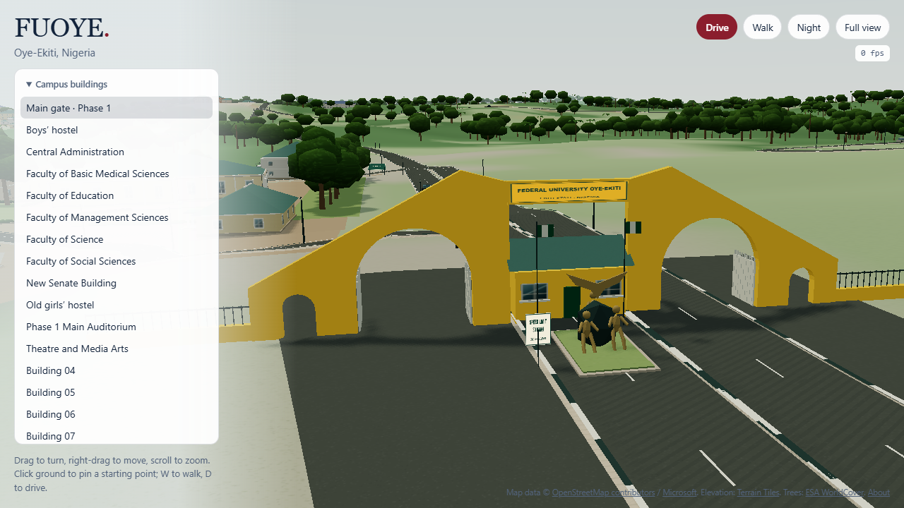
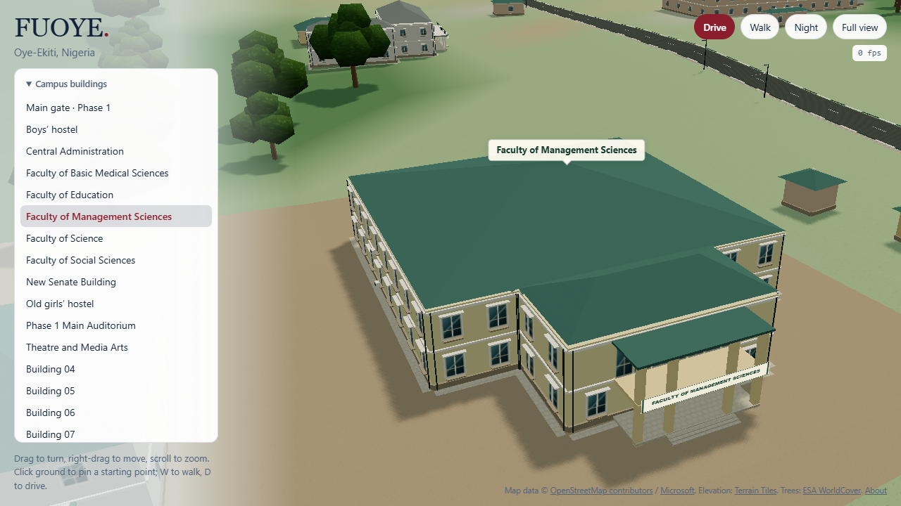

<div align="center">

# FUOYE Explore

### Oye campus, in three dimensions.

Walk through the main gate. Explore familiar places. Drive across campus.

**Federal University Oye-Ekiti · Oye-Ekiti, Nigeria**

[Get started](#get-started) · [Explore the features](#the-experience) · [Controls](#controls) · [Data and accuracy](#data-and-accuracy) · [Contribute](#contributing)

</div>



**FUOYE Explore** is an interactive browser reconstruction of FUOYE’s Oye campus. It combines mapped building footprints, terrain elevations and documented visual observations with walking, driving and a campus delivery game.

The project starts at the **main entrance beside Phase 1** and covers Phases 1, 2 and 3. Its layout and interactions take inspiration from [Mount Allison in 3D](https://mount-alison-3d.vercel.app/), with original implementation, procedural materials and FUOYE-specific campus geometry.

| Campus coverage | Named places | Building directory | Ways to explore |
| :---: | :---: | :---: | :---: |
| **108** building polygons | **11** matched places | **62** building entries | **Orbit · Walk · Drive** |

> **Project status:** a working reconstruction under active refinement. This is an independent student project. Names, geometry and architectural details have different levels of confidence; it is not an official university map or a surveyed digital twin.

## Contents

- [The experience](#the-experience)
- [Get started](#get-started)
- [Controls](#controls)
- [Campus coverage](#campus-coverage)
- [Data and accuracy](#data-and-accuracy)
- [Designed to stay lightweight](#designed-to-stay-lightweight)
- [Development guide](#development-guide)
- [Validation](#validation)
- [Contributing](#contributing)
- [Troubleshooting](#troubleshooting)
- [Sources and credits](#sources-and-credits)

## The experience

### Explore at your own pace

The fullscreen scene opens at the Phase 1 gate. Use the floating building directory to focus a destination, orbit around its architecture or switch to **Full view** to understand the campus layout. Named buildings have frontage signs and nearby labels; phase markers help with orientation.

Click or tap clear ground to choose your next starting point. **Walk here** and **Drive here** begin there, with nearby adjustments when a selected point is obstructed. Leaving either mode returns to a close view of your current location.

### Walk, drive and deliver

Explore on foot with running, jumping and mouse-look, or take a car into free drive. **Campus Courier** adds timed deliveries: follow the gold guide, slow down inside the destination ring and earn points and extra time. Your best score stays in the browser.

Switch to **Night** for illuminated windows, lamps, stars and a vehicle headlight. Touch controls support walking and driving on smaller screens.

### Recognizable buildings and grounds

The visual pass adds distinct treatments to Management Sciences, the boys’ hostel and Central Administration using saved contributor photos. Other refinements include the Phase 1 sports complex (featuring a regulation East-West football pitch, running track, basketball and volleyball courts, floodlight towers, and spectator bleachers), the Phase 1 auditorium, varied nearby tree crowns, separate observed lawn patches, roof details, window reveals and park/path edging.

<details>
<summary><strong>View the Management Sciences model</strong></summary>



The frontage uses photo-informed columns and glazing. Dimensions, unseen elevations and some detailing remain inferred. Both README screenshots show the implemented scene from the 11 October 2026 visual-validation checkpoint.

</details>

### Review the evidence

The companion **map and identification workspace** at `/review.html` lets you select footprints, inspect sources, and save names, identification status and evidence notes. Export and import JSON backups to preserve your work. Reload the explorer to pick up saved names.

Notes and scores are stored locally in the browser. No account or backend is required. Street-map tiles in the review workspace are opt-in; the default view uses bundled data.

## Get started

### Requirements

- **Node.js 22.12 or newer** and npm. This supports the Vite build and the TypeScript unit-test command used by this repository.
- A browser with **WebGL support** for the 3D explorer.
- **Google Chrome** for the optional Playwright browser checks.

Python is only needed when regenerating prepared data. The runtime datasets are already included.

### Run locally

```sh
git clone https://github.com/Cyberpunk738/fuoye-explore.git
cd fuoye-explore
npm ci
npm run dev
```

Open **http://127.0.0.1:5173/** for the explorer, or **http://127.0.0.1:5173/review.html** for the map workspace. If the port is occupied, use the address printed by Vite.

### Build and preview

```sh
npm run build
npm run preview
```

The build first checks TypeScript, then writes the explorer and review workspace to `dist/`. Open the preview URL printed in the terminal.

The output can be served by a static host at the site root. Keep both `index.html` and `review.html`, together with the generated assets and data directories. The current configuration assumes root hosting; a subdirectory deployment needs its base and absolute asset paths reviewed.

No API keys or environment file are needed for the bundled explorer. After the initial application and data load, the main scene makes no runtime map or elevation API requests. This does not imply service-worker caching or guaranteed offline reloads.

## Controls

### Orbit and navigation

| Action | Desktop | Touch |
| --- | --- | --- |
| Rotate the view | Drag | Drag |
| Move the view | Right-drag (screen-space pan) | Use directory focus or tap ground |
| Zoom | Mouse wheel | Pinch |
| Focus a building | Click the building or directory entry | Tap the building or directory entry |
| Center view and set starting point | Click open ground to fly camera and pin start | Tap open ground to center view and pin start |
| Start immediately under the cursor | Hover over ground, then press **W** or **D** | Use the ground-point actions |
| Fit the campus | **Full view** | **Full view** |
| Return to the entrance | **Main gate · Phase 1** in the directory | Same |
| Switch lighting | **Night** / **Day** | Same |

A pinned starting point also applies to the top **Walk** and **Drive** controls. Dragging the orbit view or focusing another building clears the pin. Blocked positions move to nearby safe ground, with extra clearance for the car.

### Walking

| Action | Control |
| --- | --- |
| Move | **WASD** or arrow keys |
| Run | Hold **Shift** |
| Jump | **Space** |
| Look around | Click the scene for mouse-look; drag when pointer lock is unavailable |
| Release mouse-look | **Escape** |
| Leave walking | **Exit walk**, or **Escape** after mouse-look is released |
| Touch movement | Left thumb moves; right thumb looks |

Exiting returns to a close orbit around your current location. Use **Full view** when you want the campus-wide view.

### Driving and Campus Courier

| Action | Control |
| --- | --- |
| Accelerate, brake/reverse and steer | **WASD** or arrow keys; on-screen controls on touch devices |
| Handbrake / drift | **Space** |
| Reset to a nearby road | **R** |
| Leave driving | **Escape**, or **Exit** in the driving menu |
| Explore without the timer | Choose **Free drive** |
| Begin deliveries | Choose **Start** in Campus Courier |

Courier runs begin with **75 seconds**. Follow the gold arrow/beacon and slow down inside the delivery ring. Successful deliveries add points and time, then select another destination. Start and Free drive preserve your chosen position; resetting with **R** deliberately relocates the car to a road.

## Campus coverage

The 108 polygons include secondary wings and small supporting structures. The 62-entry building directory groups or excludes these supporting parts to keep navigation useful; the gate and sports complex are additional landmark entries.

Current named destinations:

| Academic buildings | Other destinations |
| --- | --- |
| Faculty of Management Sciences | Central Administration |
| Faculty of Science | New Senate Building |
| Faculty of Education | Phase 1 Main Auditorium |
| Faculty of Basic Medical Sciences | Phase 1 Sports Complex |
| Faculty of Social Sciences | Boys’ hostel |
| Theatre and Media Arts | Old girls’ hostel |

Names are matched to Maps pins or visible compounds, with confidence and evidence recorded in the [campus inventory](research/oye-campus-inventory.json). Unknown buildings remain numbered. The modeled area is scene coverage, not an official property boundary.

## Data and accuracy

The reconstruction keeps source geometry, visual observations and estimated details distinguishable.

| Layer | Basis | What remains approximate |
| --- | --- | --- |
| Building footprints | OpenStreetMap, Microsoft footprints and explicitly recorded visual traces | Detection errors, traced roof edges and alignment |
| Place names | Maps listings and visible compounds | Exact occupancy and ambiguous compound matches |
| Architecture | Saved photos, satellite roof observations and procedural profiles | Most heights, window spacing, roof pitch and unseen facades |
| Main entrance | Satellite alignment, a wide entrance photo and user confirmation of the Phase 1 location | Dimensions, sculpture details and ground grading |
| Sports complex | Observed satellite layout, regulation pitch and court dimensions | Surface wear, track lane markings, and exact spectator seating capacity |
| Roads and paths | OSM lines plus documented local observations | Widths, markings, kerbs and street furniture |
| Terrain | Mapzen Terrain Tiles / USGS elevation data | Source resolution, smoothing and estimated foundation grading |
| Vegetation | ESA WorldCover 2021 and observed planted areas | Individual tree positions, species, heights and hedge placement |

**Image access dates are not capture dates.** The saved Management Sciences photo dates to November 2021, Administration to October 2021, and the boys’ hostel to November 2022. The auditorium interior photo dates to May 2022. Satellite acquisition dates are unavailable, so these sources do not establish every building’s condition in 2026.

The Senate and other unphotographed facades retain estimated details. Generated nameplates and phase signs are navigation aids, not verified reproductions of physical signs. Reference photographs and downloaded reference implementation files are not served as application assets.

For the supporting records, see:

- [Source metadata](public/data/scene-sources.json) — origins, processing and limitations.
- [Campus research](research/oye-campus-research.md) — place matching and research notes.
- [Site observations](research/oye-site-observations.json) — attributed local geometry.
- [Entrance and identification](research/entrance-and-identification.md) — gate and signage evidence.
- [Phase 1 visual pass](research/phase1-visual-pass.md) and [campus refinement](research/campus-visual-pass.md) — observed features and inferred treatments.
- [Reference comparison](research/reference-parity.md) — interaction and visual reference notes.

## Designed to stay lightweight

Rendering work is bounded so additional detail does not require a continuously busy scene.

| Technique | Current implementation |
| --- | --- |
| Render scheduling | Navigation capped at **24 fps**; idle, hidden and offscreen scenes stop rendering |
| Resolution | **1280 × 720** render ceiling |
| Tree rendering | Shared, spatially grouped instances; at most **3,200** trees |
| Nearby detail | At most **480** broadleaf trees use grouped crowns and branches |
| Materials | Lambert shading and small, original procedural textures |
| Shadows | One cached **1024 × 1024** shadow map, refitted on building focus |
| Slow-frame fallback | Reduced resolution and disabled shadows |
| Reduced motion | Shorter camera flights and no walking bob |
| Night lighting | Emissive surfaces, lamp sprites and one unshadowed headlight |

The scene avoids post-processing, ambient occlusion, animated crowds and background traffic. The terrain uses 96 × 96 cells, with observed ground areas fitted to the rendered terrain.

**Recorded checkpoint — 11 October 2026:**

| View | Rendered triangles | Draw calls |
| --- | ---: | ---: |
| Opening gate | 256,066 | 160 |
| Faculty of Science | 217,110 | 75 |
| Full campus | 267,714 | 236 |

The full-view checks enforce fewer than **350,000 triangles** and **250 draw calls**. Full view uses distant tree shapes; idle rendering stops. These are software-WebGL geometry measurements, not a guaranteed frame rate on every device.

## Development guide

### Stack

| Tool | Role |
| --- | --- |
| **TypeScript** | Application logic, controls and scene construction |
| **Three.js** | WebGL rendering, geometry, materials and cameras |
| **Vite** | Local development and the two-page production build |
| **Leaflet** | Map and identification workspace |
| **Playwright + Node test runner** | Browser checks and unit tests |
| **Python** | Offline data preparation and optional source processing |

### Project structure

```text
fuoye-explore/
├── index.html                 # 3D explorer entry
├── review.html                # Map workspace entry
├── src/
│   ├── explorer.ts            # Explorer interface and directory
│   ├── explorer-scene.ts      # Scene, camera and interaction orchestration
│   ├── data.ts                # Data types, loading and saved notes
│   └── world/                 # Geometry, terrain, trees, navigation and gameplay
├── public/data/               # Prepared runtime datasets and source metadata
├── research/                  # Canonical inventory, observations and evidence
├── scripts/                   # Data preparation and browser checks
├── tests/                     # Unit tests
├── docs/images/               # README screenshots
├── vite.config.ts             # Explorer + review build entries
└── package.json               # Commands and dependencies
```

### Updating campus data

Edit the canonical [inventory](research/oye-campus-inventory.json) and [site observations](research/oye-site-observations.json), then regenerate:

```sh
npm run data:campus
```

This runs offline and combines `public/data/oye.geojson` with those research records to produce `public/data/campus.geojson` and `public/data/campus-places.json`. Include the canonical changes and generated files together when committing a data update.

For deeper data work:

- `npm run data` rebuilds the wider footprint extract from the included raw inputs. It is not needed for normal development.
- `scripts/prepare_terrain.py` requires Python and Pillow.
- `scripts/prepare_landcover.py` requires Python, rasterio and certifi; it reads the Oye window from ESA’s public cloud-optimized GeoTIFF and needs network access.
- Historical seed/apply/fix scripts are one-off migration tools, **not** the build pipeline. Some overwrite later refinements.

## Validation

For normal code changes:

```sh
npm test
npm run build
```

Browser checks use installed Google Chrome and a running **Vite dev server**, normally at `http://127.0.0.1:5173/`. Some checks import development modules directly, so use `npm run dev` rather than the production preview. Run browser suites sequentially to avoid competing for graphics resources.

| Command | Coverage |
| --- | --- |
| `npm test` | Notes, geometry, elevation, render scheduling, physics, delivery rules and data provenance |
| `npm run build` | TypeScript checking and production build |
| `npm run test:browser` | Directory focus, driving, walking/jumping, day/night, mobile interaction, review routing and render budgets |
| `npm run test:review` | Footprints, evidence links, note persistence and no external requests in the default view |
| `npm run test:routes` | Access to all 11 delivery stops and scoring/time/next-target rules |
| `npm run test:entrance` | Opening gate, signage and clear vehicle lanes |
| `npm run test:walk-start` | Hover/touch walking starts |
| `npm run test:transitions` | Pinned starts, nearby exits, obstacle adjustment, mobile controls and idle rendering |
| `npm run test:landscape` | Eight campus views, geometry limits, near/far trees, walking, day/night and idle rendering |

For a different dev-server address, set `BASE_URL`. In PowerShell:

```powershell
$env:BASE_URL = "http://127.0.0.1:5174/"
npm run test:landscape
```

Screenshots and reports are written to ignored `output/`. At the last implementation checkpoint, **28 unit tests**, the production build, landscape checks, desktop/mobile gameplay, transitions, routes and entrance checks passed. This is a dated checkpoint, not a live CI badge.

The route audit permits off-road travel and does not replace driving complete deliveries by keyboard or touch. The reference inspection script is a research aid rather than a required application test.

## Contributing

Useful contributions include better building identification, current exterior evidence, accessibility improvements and measured performance fixes.

1. **Give the location and evidence.** For a campus correction, include the building name or coordinates, a source link and the photo capture date if known. Keep guesses explicit.
2. **Preserve the existing map relationships.** Do not assign a place to the nearest footprint solely because it is nearby. Keep Oye and Ikole campus records distinct.
3. **Keep changes focused.** Reuse shared geometry and materials, preserve exact-point Walk/Drive entry, and retain source attribution.
4. **Validate the affected behavior.** Run unit/build checks for code changes and relevant browser suites for scene or interaction changes. Compare geometry budgets after adding detail.
5. **Describe the result.** Explain the change, evidence and validation in the pull request. Use conventional commit prefixes such as `feat:`, `fix:`, `docs:` and `test:`.

Report reproducible problems through [GitHub Issues](https://github.com/Cyberpunk738/fuoye-explore/issues). Include the browser, device, location/view, steps to reproduce and a screenshot when useful.

## Troubleshooting

| Symptom | What to check |
| --- | --- |
| The FPS counter reads `0` while the scene is still | Expected: idle rendering stops. Move the camera to resume rendering. |
| The 3D scene is blank or unavailable | Check browser WebGL/hardware-acceleration support and the developer console. The map workspace remains a separate entry point. |
| Camera movement feels slow | The navigation cap is 24 fps. Close other graphics-heavy tabs; device performance and the automatic fallback also affect quality. |
| A browser test cannot connect | Start `npm run dev`, check its actual port, and set `BASE_URL` if needed. |
| Playwright cannot find Chrome | Install Google Chrome; these scripts explicitly select its `chrome` channel. |
| Renamed buildings have not changed in the explorer | Save the note in `/review.html`, then reload the explorer on the same origin. |
| Notes or scores seem missing | Browser storage is per browser/profile and origin. `localhost` and `127.0.0.1` are different origins; export note backups before clearing storage. |
| The build reports a chunk-size warning | The current shared Three.js bundle exceeds Vite’s advisory threshold. Check the exit status; the warning alone is not a failed build. |

## Sources and credits

| Source | Contribution / attribution |
| --- | --- |
| [OpenStreetMap contributors](https://www.openstreetmap.org/copyright) | Mapped footprints and roads · ODbL |
| [Microsoft Global ML Building Footprints](https://github.com/microsoft/GlobalMLBuildingFootprints) | Supplemental building outlines · CDLA Permissive 2.0 |
| [Mapzen Terrain Tiles](https://registry.opendata.aws/terrain-tiles/) | Elevation, with underlying data attribution including USGS recorded in the source metadata |
| [ESA WorldCover 2021 v200](https://doi.org/10.5281/zenodo.7254221) | Land-cover classification · CC BY 4.0 |
| [FUOYE on Google Maps](https://maps.app.goo.gl/yDcJm6EFjyrKhLUY6) | Place listings, visual inspection and contributor photo references |
| [Mount Allison in 3D](https://mount-alison-3d.vercel.app/) by [0xbigturk](https://x.com/0xbigturk) | Layout, visual and interaction inspiration |

Additional university and photographic references are retained in the research records. Data-source licenses apply to their respective datasets; this table does not declare a license for the application code.

---

<div align="center">

**FUOYE Explore** · A growing, evidence-led reconstruction of Oye campus.

[Back to top](#fuoye-explore)

</div>
